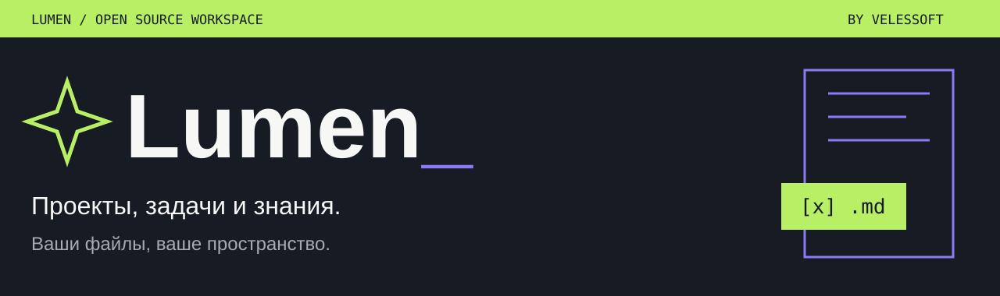
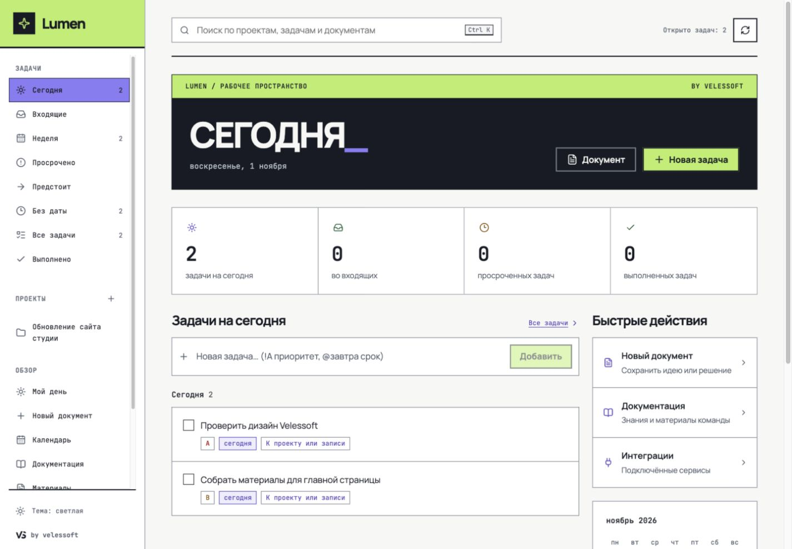
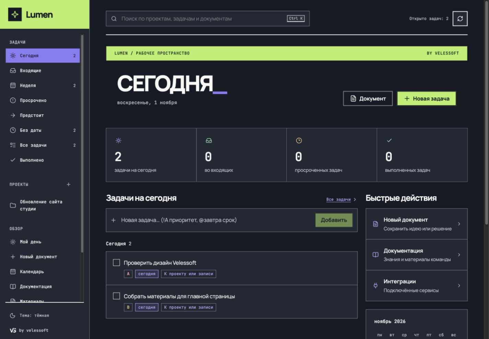

<p align="center">
  
</p>

<p align="center">
  <a href="https://github.com/villetacore/lumen/actions/workflows/ci.yml"></a>
  <a href="LICENSE"></a>
  <a href="server/go.mod"></a>
  <a href="web/package.json"></a>
</p>

<p align="center">
  <a href="#быстрый-старт">Быстрый старт</a> ·
  <a href="docs/README.md">Документация</a> ·
  <a href="docs/plans/PROGRESS.md">Статус проекта</a> ·
  <a href="CONTRIBUTING.md">Участие в разработке</a>
</p>

**Lumen — открытое рабочее пространство для проектов, задач и знаний.**
Заметки и задачи живут в обычных Markdown-файлах. Веб-интерфейс связывает их
с календарём, документами и внешними сервисами, а один Go-бинарник запускает
всё приложение на вашем компьютере или сервере.



<details>
<summary>Тёмная тема</summary>



</details>

Скриншоты сняты на демонстрационном хранилище. Интерфейс использует дизайн-систему
Velessoft RIOT: Manrope, JetBrains Mono, графит, лайм и фиолетовый; шрифты поставляются локально.

## Возможности

- **Задачи на каждый день.** Сегодня, неделя, входящие, просроченное; быстрый ввод
  `Подготовить макет !A @завтра`, сроки, приоритеты и подробные описания.
- **Проекты и знания вместе.** Проектные документы, вложенные материалы, Markdown,
  `[[wikilinks]]`, теги, обратные ссылки и поиск.
- **Редактирование с защитой черновика.** Внешние правки и конфликты версий
  показываются в редакторе; несохранённый текст остаётся доступен.
- **Календарь и интеграции.** ICS, CalDAV, Nextcloud Notes, GitHub и Gitea.
  Импортированные материалы сохраняют локальные дополнения вне блока источника.
- **Своё хранилище.** Обычная папка файлов, совместимый Markdown, опциональное
  шифрование содержимого. Заметки можно редактировать вне Lumen.
- **Самостоятельное размещение.** Встроенный веб-клиент, контейнер, Bearer-токен
  или OIDC/Keycloak. Чтение паролей из Bitwarden/Vaultwarden/KeePass через CLI.

## Быстрый старт

Для сборки нужны **Go 1.26**, **Node.js 24+**, npm, Git и Make.
На Windows используйте [PowerShell-инструкцию](docs/GETTING_STARTED.md#сборка-на-windows).

```bash
git clone https://github.com/villetacore/lumen.git
cd lumen
npm ci --prefix web
make app
./dist/lumend --vault ./my-vault --open
```

Откроется **http://127.0.0.1:8787**. Отсутствующая папка `my-vault` создастся
автоматически. После сборки Node.js не нужен: веб-клиент встроен в `lumend`.

Для разработки с hot reload запустите `make dev`: интерфейс будет доступен
на **http://localhost:5173**, данные — в отдельной `.dev-vault`.

### Docker

```bash
docker run -d --name lumen \
  -p 127.0.0.1:8787:8787 \
  -v lumen-vault:/vault \
  ghcr.io/villetacore/lumen:main
```

Этот пример доступен только локально. Для сервера настройте HTTPS и
[авторизацию](docs/AUTH.md); для воспроизводимой установки закрепите тег коммита.
Обновление, резервное копирование и откат описаны в [инструкции эксплуатации](docs/OPERATIONS.md).

## Документация

| Я хочу… | Куда перейти |
|---|---|
| Запустить Lumen и создать первые записи | [Начало работы](docs/GETTING_STARTED.md) |
| Разобраться с задачами, проектами и документами | [Руководство пользователя](docs/USER_GUIDE.md) |
| Подключить календарь или трекер | [Интеграции](docs/INTEGRATIONS.md) |
| Разместить на своём сервере | [Сборка и доставка](docs/DEPLOY.md) · [Эксплуатация](docs/OPERATIONS.md) |
| Изменить код | [Разработка](docs/DEVELOPMENT.md) · [Архитектура](docs/ARCHITECTURE.md) |
| Работать через API или с файлами | [HTTP API](docs/API.md) · [Формат Markdown](spec/FORMAT.md) |
| Найти остальные инструкции | [Каталог документации](docs/README.md) |

## Состояние и направление

Lumen активно развивается. Текущая рабочая область — **Go-сервер и React-клиент**.
Один экземпляр `lumend` обслуживает один vault; все допущенные пользователи имеют
доступ ко всему хранилищу. Индекс и внешние календарные события находятся в памяти;
после перезапуска календарь загружается из источников повторно.

Следующее направление — [AI-центр управления студией](docs/plans/PRODUCT_DIRECTION.md):
поручения, агенты, проверяемые результаты и общие права доступа. **Агентный runtime,
RAG, MCP и проектные ACL пока не реализованы.** Порядок работ — в
[плане реализации](docs/plans/IMPLEMENTATION_GUIDE.md), фактические результаты — в
[журнале](docs/plans/PROGRESS.md). Исторический Flutter/Rust-клиент остаётся в
`desktop/` и не входит в текущий цикл проверки backend/web.

## Участие

Баги и предложения принимаются в [Issues](https://github.com/villetacore/lumen/issues).
Для pull request начните с [CONTRIBUTING.md](CONTRIBUTING.md): там описаны локальные
проверки, границы изменений и требования к сохранности данных.
Об уязвимостях — [SECURITY.md](SECURITY.md).

## Лицензия

Код распространяется по [MIT](LICENSE). Manrope и JetBrains Mono — по
[SIL Open Font License](web/public/fonts/). Создано в **velessoft**.
