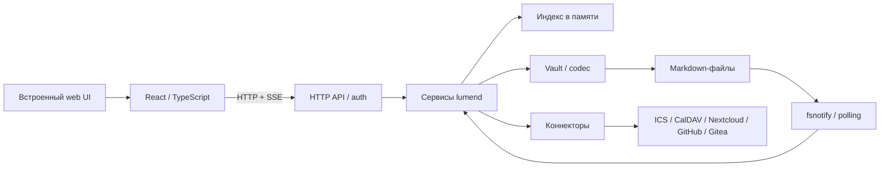

# Текущая архитектура

Этот документ описывает реализованные Go-сервер и React-клиент. Целевая архитектура
студийной платформы находится в [plans/ARCHITECTURE.md](plans/ARCHITECTURE.md);
агентный runtime, SQL persistence, RAG и MCP не входят в текущую схему.

## Один процесс, файловое хранилище

`make app` встраивает production-сборку Vite в `lumend` через `go:embed`.
В режиме разработки Vite работает отдельно и проксирует API на Go-сервер.
Нет обязательной внешней БД, очереди или поискового кластера.

## Границы модулей

| Модуль | Ответственность |
|---|---|
| `domain`, `markdown` | Сущности, формат задач, frontmatter, ссылки и точечные правки |
| `vault`, `crypt` | Файловые операции, атомарная запись, codec шифрования |
| `index` | Перестраиваемый индекс в памяти |
| `service` | Сценарии заметок/задач, связей, импорта и индексации |
| `watch` | Изменения файлов, debounce и запасной polling |
| `httpapi`, `auth` | REST, SSE, Bearer-токены и OIDC-сессии |
| `integrations` | Коннекторы, конфигурация и cursor/state |
| `secrets`, `passwords` | Разрешение ссылок на секреты и чтение внешних хранилищ |
| `webui` | Встроенные статические файлы и fallback для маршрутов UI |

HTTP вызывает service; бизнес-операции работают с domain, vault и index.
`domain` не зависит от HTTP и диска. Принятые решения сохранены в [ADR](adr/).

## Данные и запись

Markdown — оригинал заметок и задач. Задачи находятся в строках чекбоксов,
стабильные ссылки используют block ID. Связи материалов с родителем хранятся
в frontmatter. Индекс пересобирается при старте и не является резервной копией.

При изменении задачи сервис находит исходный файл, читает его и меняет нужную
строку. Read-modify-write внутри процесса сериализуется; запись проверяет revision
там, где она передаётся, после чего обновляет индекс и публикует событие.
Для заметок конфликт версии возвращается клиенту, который сохраняет draft.
Эта защита не делает совместную запись нескольких процессов безопасной.

Watcher отслеживает внешние изменения и инициирует переиндексацию. Клиенты
получают SSE-уведомления через `/api/v1/events` и обновляют TanStack Query cache.
Поток уведомлений не заменяет чтение актуальных данных через API.

## Интеграции и восстановление

Импортируемые заметки и задачи сохраняются в vault. Блок источника имеет hash:
внешнее обновление заменяет его, сохраняя локальный текст снаружи. Конфликт
ручной правки внутри блока останавливает обновление. Старые материалы перед
миграцией копируются в `.lumen/backups/imports/` через codec vault.

Cursor сохраняется после полного применения результата. Внешние календарные
события находятся в памяти и загружаются повторно после рестарта; для этого
нужен доступ к источнику. Новые task ID включают connection ID, но миграция
старых коллизий и UI разрешения конфликтов ещё не завершены (LUM-005).

## Клиент и доступ

React Router управляет маршрутами, TanStack Query — серверными данными, React
state — локальным состоянием интерфейса. Markdown-редактор использует textarea;
CodeMirror запланирован отдельно. API-типы поддерживаются вручную.
Стили, темы и шрифты описаны в [дизайн-системе](../web/src/design/README.md).

Авторизация допускает локальный режим, статический Bearer-токен и OIDC.
Все допущенные пользователи видят общий vault; ACL по проектам пока нет.
Шифрование на диске не заменяет авторизацию API.

## Ограничения текущей поставки

Один процесс на один vault; без распределённой блокировки и горизонтального
масштабирования записи. Web требует доступного backend. Межустройственный
sync-протокол и агентные очереди не реализованы в Go-сервере. Desktop в отдельном
каталоге имеет свой стек и не проверяется в текущем backend/web CI.

См. [формат](../spec/FORMAT.md), [HTTP API](API.md), [эксплуатацию](OPERATIONS.md)
и [фактический прогресс](plans/PROGRESS.md).
