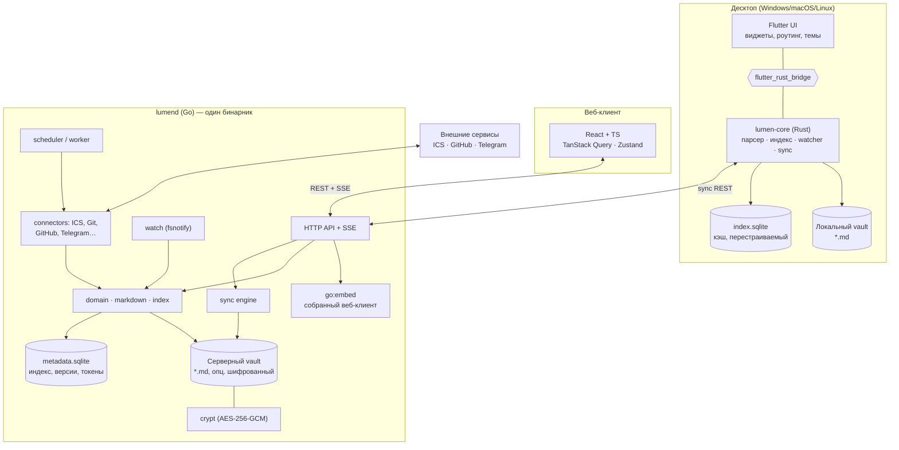
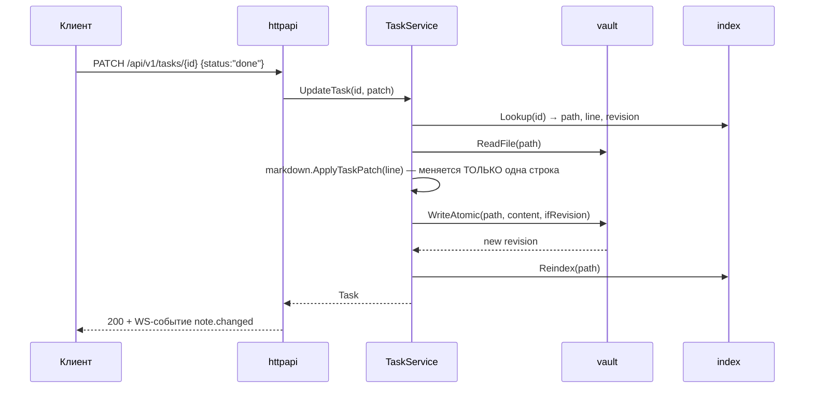
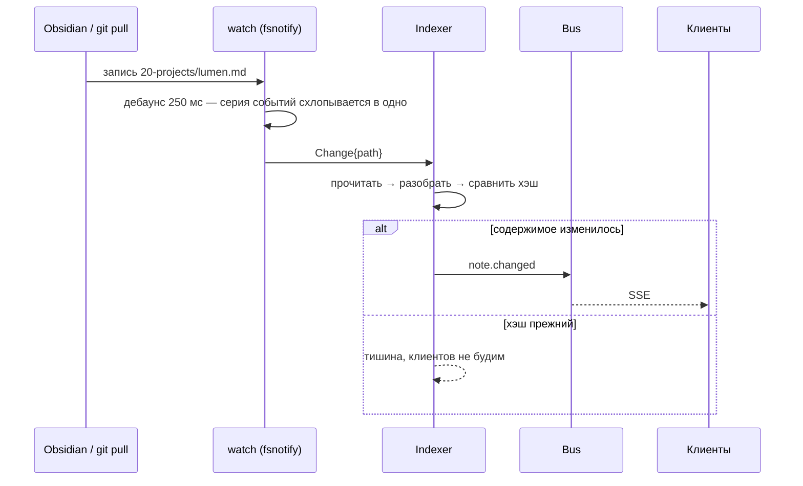

# Архитектура

> Этот документ содержит как реализованные, так и проектируемые части исходной
> архитектуры. Сверка с кодом и план развития backend/web на 2026-10-14 находятся
> в [обзоре](plans/README.md) и [целевой архитектуре](plans/ARCHITECTURE.md).
> Новые решения пока имеют статус предложения; Flutter не входит в текущий этап.

## 1. Общая картина



## 2. Ключевые решения

| Решение | Выбор | Почему |
|---|---|---|
| Источник правды | Файлы `.md` в vault | Переносимость, работа в Obsidian/git, нет vendor lock-in |
| БД | Только как **перестраиваемый индекс** | Потеря БД ≠ потеря данных; `lumen reindex` восстанавливает |
| Идентичность задачи | `^block-id` в файле, лениво присваиваемый при первой записи | Стабильные ссылки без «замусоривания» файлов при чтении |
| Синхронизация MVP | Пофайловая, версии + хэш, конфликт → файл-дубль | На порядок проще CRDT; достаточно для одного пользователя на N устройств |
| Парсер | Две реализации (Go, Rust) + общие golden-тесты | Десктопу нужен офлайн-парсер, серверу — свой; WASM/FFI связка усложнила бы сборку |
| Веб | Тонкий клиент к API, без локального vault | MVP; локальный vault в браузере (OPFS) — M4 |
| Отслеживание изменений | fsnotify с дебаунсом, опрос как запасной вариант | Реакция ~0,3 с вместо 2 с; опрос спасает на сетевых дисках |
| Шифрование | Пофайловые AES-256-GCM контейнеры, ключ в `.lumen/crypt.json` | Файлы остаются файлами, смена пароля не переписывает vault |
| Поставка | Один бинарник со вшитым UI | Локальное приложение запускается одной командой |
| Секреты | Ссылка на менеджер паролей вместо значения | Конфиг можно класть в git; мастер-ключ приложения не нужен |
| События интеграций | Живут в индексе, а не в файлах | Рабочий календарь не должен создавать тысячи заметок |

Подробнее — [ADR](adr).

## 3. Слои сервера (Go)

```
server/
  cmd/lumend/            точка входа, флаги, graceful shutdown
  internal/
    config/              конфиг (флаги + env)
    domain/              сущности и правила: Note, Task, Event, Query. Без I/O.
    markdown/            парсинг/сериализация: frontmatter, задачи, ссылки, теги
    vault/               файловое хранилище: чтение, атомарная запись, обход, Codec
    crypt/               шифрование содержимого файлов (реализует vault.Codec)
    secrets/             ссылки на секреты: env, file, command, bitwarden, keepass
    integrations/        коннекторы (ICS, CalDAV, GitHub), реестр, конфиг, SSRF-guard
    watch/               fsnotify → дебаунс → поток изменённых путей
    index/               индекс: интерфейс Store + memory-реализация (+ sqlite позже)
    service/             сценарии: Notes, Tasks, Views, Indexer, миграция шифрования
    httpapi/             роутер, хендлеры, DTO, middleware (log, recover, auth, cors)
    webui/               вшитый веб-клиент (go:embed)
    sync/                версии файлов, дельты, разрешение конфликтов
    integrations/        Connector-интерфейс и реализации
    auth/                токены/JWT, пользователи (MVP: один пользователь)
```

Зависимости идут строго внутрь: `httpapi → service → {domain, index, vault, markdown}`.
`domain` не знает ни про HTTP, ни про файлы, ни про БД.

### Поток «изменить задачу»



Правка всегда точечная: файл не переформатируется, порядок и стиль пользователя
сохраняются (см. [ADR-0003](adr/0003-lossless-edits.md)).

### Поток «файл изменили снаружи»



Уведомления файловой системы теряются (переполнение очереди, сетевые диски),
поэтому watcher делает полную сверку сразу после старта и раз в 5 минут.
Если fsnotify недоступен, индексатор молча переключается на опрос.

### Шифрование как шов

`vault.Codec` — единственное место, где данные превращаются из шифротекста
в открытый текст:

```
httpapi → service → vault.Read ──► Codec.Decode ──► файл на диске
                    vault.Write ──► Codec.Encode ──►
```

Выше `vault` никто не знает про ключ. Поэтому включение шифрования не потребовало
изменений ни в парсере, ни в индексе, ни в сервисах ([ADR-0005](adr/0005-encryption-at-rest.md)).

## 4. Десктоп

- `lumen-core` (Rust, cdylib + rlib): парсер формата, файловый watcher (`notify`),
  индекс (`rusqlite` + FTS5), sync-клиент (`reqwest`), поисковые запросы.
- Flutter — только UI и состояние экрана. Вся логика в Rust, чтобы её можно было
  переиспользовать в будущем CLI и мобильном клиенте.
- Мост — `flutter_rust_bridge` v2: генерируемые Dart-биндинги, стримы для событий
  файловой системы и прогресса синхронизации.

## 5. Веб

- Vite + React 19 + TypeScript (strict).
- Данные — TanStack Query (кэш, инвалидация по WS-событиям), локальный UI-стейт — Zustand.
- Роутинг — React Router.
- Редактор — CodeMirror 6 (Markdown-режим, wikilink-автодополнение).
- Календарь — своя сетка (месяц/неделя/день) на CSS Grid, без тяжёлых библиотек.
- API-клиент генерируется/типизируется вручную из [`docs/API.md`](API.md); типы
  сущностей лежат в `web/src/api/types.ts` и зеркалят Go-DTO.

## 6. Что где живёт (границы ответственности)

| Задача | Сервер (Go) | Десктоп (Rust) | Веб (TS) |
|---|---|---|---|
| Парсинг Markdown | ✅ | ✅ | ❌ (только рендер) |
| Индекс и поиск | ✅ | ✅ | ❌ |
| Запись в файлы | ✅ | ✅ | ❌ |
| Синхронизация | ✅ (сервер) | ✅ (клиент) | ❌ |
| Интеграции | ✅ | ❌ | ❌ |
| Рендер и UX | ❌ | ✅ | ✅ |
