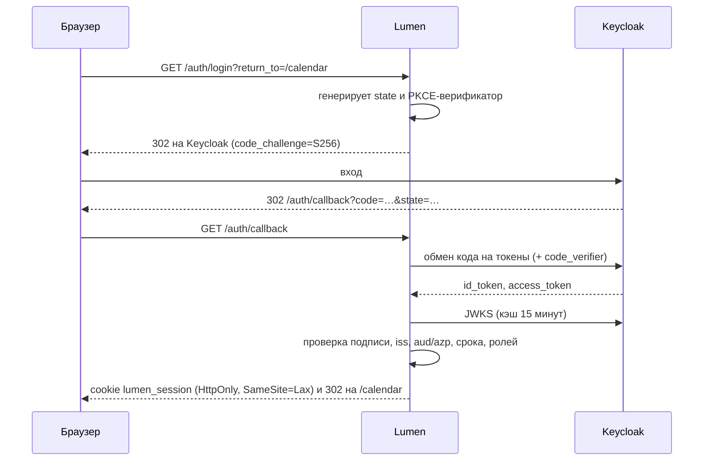

# Вход через Keycloak (и любой OIDC)

Lumen умеет жить за single sign-on: если на сервере уже стоит Keycloak и все
сервисы ходят через него, Lumen встраивается туда же и не заводит собственных
паролей.

## Три режима

| Режим | Когда | Как включается |
|---|---|---|
| Без авторизации | Локальное приложение на своей машине | По умолчанию |
| Статический токен | Скрипты, автоматизация, простой доступ извне | `--token` |
| OIDC / Keycloak | Сервер с несколькими пользователями и SSO | `--oidc-issuer` |

При включённом OIDC статический токен, если он задан, продолжает работать —
это удобный запасной путь для `curl` и cron.

## Настройка на стороне Keycloak

1. В нужном realm создайте клиента:
   - **Client ID**: `lumen`
   - **Client authentication**: `Off` для публичного клиента с PKCE, `On` —
     если хотите client secret. Lumen поддерживает оба.
   - **Valid redirect URIs**: `https://lumen.example.com/auth/callback`
   - **Valid post logout redirect URIs**: `https://lumen.example.com/*`
   - **Web origins**: `https://lumen.example.com`
2. При желании заведите роль (например `lumen-user`) и назначьте её тем, кому
   можно. Вместо роли годится и группа.

## Запуск

```bash
lumend \
  --vault /srv/vault \
  --addr 0.0.0.0:8787 \
  --public-url https://lumen.example.com \
  --oidc-issuer https://keycloak.example.com/realms/main \
  --oidc-client-id lumen \
  --oidc-roles lumen-user
```

С конфиденциальным клиентом добавьте ссылку на секрет — сам секрет в командной
строке не пишется:

```bash
  --oidc-client-secret bitwarden:lumen-oidc
  # или env:LUMEN_OIDC_SECRET, file:/run/secrets/oidc, command:…
```

Все флаги имеют парные переменные окружения: `LUMEN_OIDC_ISSUER`,
`LUMEN_OIDC_CLIENT_ID`, `LUMEN_OIDC_CLIENT_SECRET`, `LUMEN_OIDC_ROLES`,
`LUMEN_PUBLIC_URL`.

Discovery выполняется при старте: опечатка в адресе или спящий Keycloak
обнаружатся сразу, а не при первом входе.

## Как это работает



Токен наружу в JavaScript не отдаётся: браузер носит только идентификатор
сессии в HttpOnly-cookie, а сами токены остаются в памяти сервера.

## Токен Keycloak напрямую

Всё под `/api` принимает и `Authorization: Bearer <access_token>`, выданный тем
же realm. Так ходят десктопное приложение, скрипты и соседние сервисы:

```bash
TOKEN=$(curl -s -d grant_type=client_credentials -d client_id=lumen \
  -d client_secret=… https://keycloak.example.com/realms/main/protocol/openid-connect/token \
  | jq -r .access_token)

curl -H "Authorization: Bearer $TOKEN" https://lumen.example.com/api/v1/tasks?view=today
```

Проверяются подпись (RS256/384/512 по JWKS), издатель, срок действия и
принадлежность приложению: `aud` содержит client id **или** `azp` ему равен —
Keycloak заполняет их по-разному для id- и access-токенов.

## Что именно проверяется

- Подпись по ключу из JWKS. Неизвестный `kid` — повод перечитать JWKS
  (Keycloak ротирует ключи), но не повод поверить токену.
- `alg`: только RSA. `none` и HMAC отвергаются — это классическая подмена
  алгоритма.
- `iss` совпадает с настроенным realm: токен от соседнего сервиса не подойдёт.
- `exp` и `nbf` с допуском в минуту на расхождение часов.
- Роли из `realm_access.roles`, `resource_access.<client>.roles` и групп —
  если задан `--oidc-roles`.

## Права

`--oidc-roles lumen-user,admins` пускает тех, у кого есть хотя бы одна из
перечисленных ролей или групп. Пусто — пускает любого, кто прошёл вход в realm.

Кто вошёл, получает роль пространства ([ADR-0012](adr/0012-access-policy.md)):

| Роль | Что может |
|---|---|
| `admin` | Всё, включая интеграции, хранилища паролей, переиндексацию и участников проектов |
| `member` | Читать и менять заметки, задачи, тикеты и спринты |
| `viewer` | Только читать |

`--admin-roles` (`LUMEN_ADMIN_ROLES`) и `--viewer-roles` (`LUMEN_VIEWER_ROLES`) —
роли или группы Keycloak через запятую. Совпадение с admin-ролями даёт `admin`,
с viewer-ролями — `viewer`, остальные допущенные — `member`. **Если
`--admin-roles` не задан, каждый допущенный пользователь — администратор**:
так Lumen работал до появления ролей. Статический токен и локальный режим —
всегда `admin`. Роль видна в `GET /api/v1/me`.

**Закрытые проекты.** Проект трекера без участников открыт всему пространству.
Администратор пространства закрывает его, добавив первого участника
(`user:<preferred_username>` или `group:<группа>` с ролью `viewer|member|admin`),
дальше участниками управляет и администратор проекта. Закрытый проект со всеми
тикетами, спринтами, файлами в его папке и документами, привязанными к нему,
не виден посторонним ни в API, ни в поиске, тегах, календаре и событиях SSE.
Ограничение действует в Lumen: доступ к файлам vault на диске, в Obsidian или
Nextcloud оно не закрывает.

**Справочник людей.** Учётные записи ведёт Keycloak. Lumen запоминает тех, кто
вошёл через OIDC: имя, `preferred_username`, почту, группы и роль на момент
последнего запроса (обновление не чаще раза в 5 минут, сразу — при смене групп
или роли). Справочник — в операционной БД; он нужен для выбора исполнителей и
участников, страница «Команда» показывает его. Локальный режим и токен в него
не попадают. Пересозданная в Keycloak учётная запись с тем же логином заменяет
прежнюю.

## Что дальше

- Обновление access-токена по refresh-токену (сейчас сессия живёт `--session-ttl`).
- Отключение пользователей, удалённых в Keycloak (сейчас запись остаётся до входа нового владельца логина).
- Вход в десктопном приложении через системный браузер.
