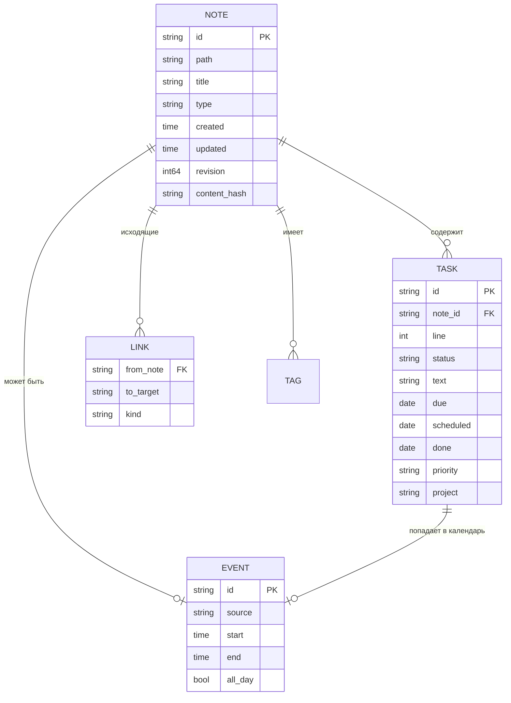

# Модель данных

Файлы — источник правды. Всё ниже — это **производный индекс**, который можно
удалить и перестроить командой `lumend reindex`.

## Сущности домена



## Go-типы (сокращённо)

```go
type Note struct {
    ID        string            // ULID из frontmatter либо путь
    Path      string            // относительный путь в vault, с '/'
    Title     string
    Type      NoteType
    Tags      []string
    Frontmatter map[string]any  // сырой frontmatter, включая неизвестные поля
    Body      string
    Links     []Link
    Tasks     []Task
    Created   time.Time
    Updated   time.Time
    Revision  int64             // счётчик версии файла на сервере
    Hash      string            // sha256 содержимого
}

type Task struct {
    ID        string     // ^blockid или вычисляемый
    NoteID    string
    NotePath  string
    Line      int        // 0-based номер строки
    Indent    int
    Status    TaskStatus // todo | doing | done | cancelled | deferred
    Text      string     // текст без инлайн-полей и blockid
    Raw       string     // исходная строка целиком
    Tags      []string
    Due       *Date
    Scheduled *Date
    Start     *Date
    Done      *Date
    Priority  Priority   // A | B | C | D | ""
    Estimate  *time.Duration
    Project   string
    Fields    map[string]string // прочие [k:: v]
}

type Event struct {
    ID      string
    Source  EventSource // note | task | daily | ics
    RefID   string      // id заметки/задачи
    Title   string
    Start   time.Time
    End     time.Time
    AllDay  bool
    Color   string
}
```

## Индекс (SQLite, серверный)

MVP-реализация индекса — **в памяти** (`index/memory`), интерфейс один:

```go
type Store interface {
    PutNote(context.Context, *domain.Note) error
    DeleteNote(ctx context.Context, path string) error
    Note(ctx context.Context, idOrPath string) (*domain.Note, error)
    Notes(ctx context.Context, q domain.NoteQuery) ([]*domain.Note, error)
    Tasks(ctx context.Context, q domain.TaskQuery) ([]*domain.Task, error)
    Task(ctx context.Context, id string) (*domain.Task, error)
    Events(ctx context.Context, from, to time.Time) ([]*domain.Event, error)
    Search(ctx context.Context, q string, limit int) ([]domain.SearchHit, error)
    Backlinks(ctx context.Context, noteID string) ([]*domain.Note, error)
    Stats(context.Context) (domain.Stats, error)
}
```

Схема SQLite (M2), одинаковая на сервере и в десктопном ядре:

```sql
CREATE TABLE notes (
  id TEXT PRIMARY KEY, path TEXT UNIQUE NOT NULL, title TEXT, type TEXT,
  created INTEGER, updated INTEGER, revision INTEGER, hash TEXT,
  frontmatter TEXT  -- json
);
CREATE TABLE tasks (
  id TEXT PRIMARY KEY, note_id TEXT NOT NULL REFERENCES notes(id) ON DELETE CASCADE,
  line INTEGER, indent INTEGER, status TEXT, text TEXT, raw TEXT,
  due INTEGER, scheduled INTEGER, start INTEGER, done INTEGER,
  priority TEXT, estimate INTEGER, project TEXT, fields TEXT
);
CREATE INDEX tasks_due ON tasks(due);
CREATE INDEX tasks_status ON tasks(status);
CREATE TABLE links (from_note TEXT, to_target TEXT, kind TEXT);
CREATE TABLE tags  (note_id TEXT, tag TEXT);
CREATE VIRTUAL TABLE notes_fts USING fts5(title, body, content='');
```

## Запросы (Query)

Представления UI — это `TaskQuery`, а не отдельные сущности:

```go
type TaskQuery struct {
    Status     []TaskStatus
    DueBefore  *Date
    DueAfter   *Date
    Scheduled  *DateRange
    Tags       []string
    Project    string
    PathPrefix string
    Text       string
    Overdue    bool
    Sort       []SortKey // due, priority, path, line
    Limit, Offset int
}
```

Готовые представления MVP:

| Представление | Запрос |
|---|---|
| Inbox | `path_prefix=00-inbox/ AND status in (todo,doing)` |
| Сегодня | `(due <= today OR scheduled == today) AND status in (todo,doing)` |
| Просрочено | `due < today AND status in (todo,doing)` |
| Неделя | `due in [пн..вс] OR scheduled in [пн..вс]` |
| Проект | `project == X OR path_prefix == 20-projects/X` |
