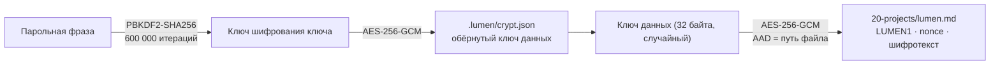

# Шифрование vault

Шифрование опционально и включается на конкретной папке. Пока оно выключено,
vault — обычные `.md` файлы, которые открываются в Obsidian и любом редакторе.

## Как это устроено



Ключевые свойства:

- **Ключ данных случайный и постоянный.** Парольная фраза только разворачивает его,
  поэтому `crypt passwd` переписывает 200 байт ключевого файла, а не весь vault.
- **Каждый файл — самостоятельный контейнер:** префикс `LUMEN1`, 12-байтный nonce,
  шифротекст с тегом аутентификации.
- **Путь входит в AAD.** Подменить `passwords.md` содержимым другого файла нельзя —
  расшифровка не пройдёт проверку целостности.
- **Открытые файлы читаются как есть.** Незашифрованный `.md` внутри зашифрованного
  vault не ломает работу, поэтому прерванную миграцию можно просто повторить.

## Что НЕ скрыто

Осознанные ограничения MVP — важно понимать до включения:

| Видно наблюдателю с доступом к диску | Почему |
|---|---|
| Имена файлов и папок | Шифрование имён ломает пути, `[[ссылки]]` и API-идентификаторы |
| Структура vault, количество заметок | Следствие того же |
| Размер каждой заметки (± 34 байта) | Нет паддинга |
| Время изменения файлов | Метаданные файловой системы |

Содержимое заметок, задач, тегов и frontmatter — скрыто.

Шифрование защищает от чтения украденного диска, бэкапа или папки в чужом облаке.
Оно **не** защищает от того, кто получил доступ к работающей системе: пока `lumend`
запущен, ключ лежит в его памяти, а API отдаёт открытый текст.

## Команды

```bash
# включить: создаётся ключ и шифруются все существующие заметки
lumend crypt init --vault ./notes

# состояние (в том числе незавершённая миграция)
lumend crypt status --vault ./notes

# дошифровать файлы, добавленные в обход Lumen
lumend crypt encrypt --vault ./notes

# сменить парольную фразу — файлы не переписываются
lumend crypt passwd --vault ./notes

# вернуться к обычному markdown
lumend crypt decrypt --vault ./notes
```

Парольная фраза берётся, в порядке приоритета:

1. `--passphrase-from <ссылка>` — в том числе из менеджера паролей;
2. `--passphrase-file <файл>` (первая строка);
3. переменная `LUMEN_PASSPHRASE`;
4. канал stdin (`echo secret | lumend …`);
5. запрос в терминале без эха.

Такой порядок означает, что служба или контейнер никогда не зависнет в ожидании ввода.

Ссылка на секрет умеет доставать фразу из Bitwarden/Vaultwarden, KeePass или
любой команды — см. [SECRETS.md](SECRETS.md):

```bash
lumend --vault ./notes --passphrase-from bitwarden:lumen-vault
lumend --vault ./notes --passphrase-from "keepass:D:/keys/db.kdbx#Lumen/vault?password=env:KDBX_PASSWORD"
lumend --vault ./notes --passphrase-from "command:pass show lumen/vault"
```

## Запуск сервера на зашифрованном vault

```bash
LUMEN_PASSPHRASE='…' lumend --vault ./notes --open
# или
lumend --vault ./notes --passphrase-from bitwarden:lumen-vault
```

Vault открывается один раз при старте. Всё, что выше пакета `vault`, работает
с открытым текстом и про ключ не знает (см. [ADR-0005](adr/0005-encryption-at-rest.md)).

## Резервные копии и восстановление

- Резервная копия `.lumen/crypt.json` **обязательна**: без него зашифрованные
  заметки не восстановит никто, включая вас.
- Парольная фраза не хранится нигде. Потеря фразы и ключа = потеря данных.
- Перед `crypt init` на реальном vault сделайте копию папки.
- Обратный путь всегда открыт: `crypt decrypt` возвращает обычные `.md`.

## Что дальше

- Argon2id вместо PBKDF2 (нужна `golang.org/x/crypto`).
- Шифрование вложений в `assets/`.
- Опциональное шифрование имён файлов с таблицей соответствия в ключевом файле.
- Ключ в системном хранилище (DPAPI / Keychain / Secret Service) как ещё один
  провайдер секретов ([ADR-0007](adr/0007-secret-references.md)).
- Сквозное шифрование при синхронизации: сервер хранит контейнеры и не может их прочитать.
