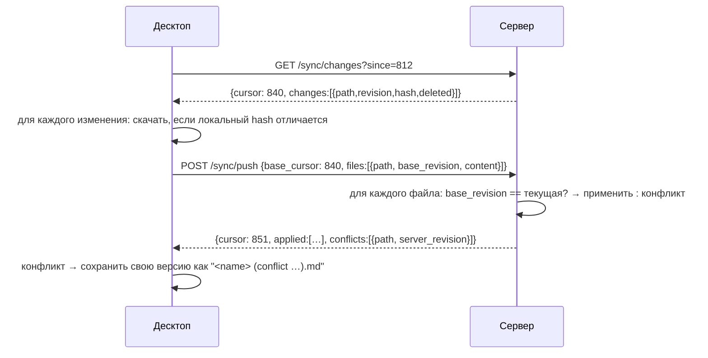

# Синхронизация

## Модель

Сервер — «истина по договорённости» (authoritative store). Клиент (десктоп)
держит полную копию vault и журнал локальных изменений.

Единица синхронизации — **файл**. Для каждого файла сервер хранит:

```
path          относительный путь
revision      монотонный счётчик (int64), общий для vault
hash          sha256 содержимого
size, mtime
deleted       tombstone (хранится 30 дней)
```

`cursor` = максимальная `revision`, которую видел клиент.

## Протокол



Правила:

1. **Быстрая проверка:** `GET /sync/state` возвращает общий хэш vault; если совпал —
   ничего не делаем.
2. **Приоритет отсутствия потерь.** Конфликт никогда не перезаписывает данные:
   локальная версия сохраняется рядом как `Заметка (conflict 2026-09-08 10-31).md`,
   серверная становится основной. Пользователь видит уведомление и diff.
3. **Удаление** — tombstone; удаление проигрывает изменению (delete-vs-edit → файл остаётся).
4. **Батчинг:** push пакетами по ≤ 200 файлов / ≤ 8 МБ.
5. **Бинарные вложения** (`assets/`) синхронизируются тем же механизмом, без парсинга.

## Что не делаем в MVP

- CRDT / пословное слияние. Отложено: см. [ADR-0002](adr/0002-sync-strategy.md).
  При переходе на CRDT протокол выше сохраняется, меняется только применение дельт.
- Трёхстороннее авто-слияние Markdown (возможный промежуточный шаг: `diff3` по строкам,
  когда правки не пересекаются).

## Локальная сторона (Rust)

```
watcher (notify) → debounce 300ms → парсинг → индекс → журнал изменений
                                                     ↘ sync-очередь → push
```

Журнал (`.lumen/cache/outbox.sqlite`) переживает перезапуск; push идемпотентен по
`(path, hash)`.
