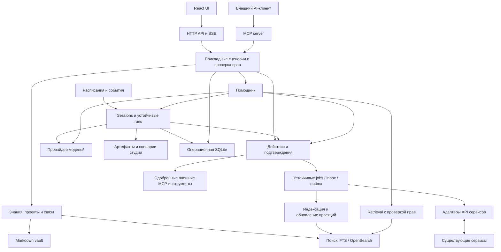

# Целевая архитектура backend

Статус: предложение. Текущее устройство см. в [существующей архитектуре](../ARCHITECTURE.md).
Продуктовая цель — [AI-центр студии](PRODUCT_DIRECTION.md). Контракты исполнения
поручений, сценариев и памяти описаны в [agent runtime](AGENT_RUNTIME.md).

## Границы системы

Сервер остаётся одним Go-приложением. Рабочие циклы запускаются в том же процессе,
но используют устойчивую очередь. Выделение worker в отдельный процесс — последующая
опция при измеренной нагрузке, а не требование первого релиза.

Предлагаемые границы пакетов: `knowledge`, `projects`, `policy`, `actions`, `jobs`,
`search`, `assistant`, `agents`, `sessions`, `playbooks`, `automations`, `artifacts`,
`mcpserver`, `mcpclient`. Это логические границы, не требование создать пустые
пакеты заранее. Существующие `domain`, `service`,
`vault`, `integrations`, `auth`, `secrets` переиспользуются и разделяются постепенно.
HTTP и MCP не вызывают друг друга по сети: оба обращаются к прикладным сервисам.
Изменения прав и бизнес-правил выполняются в сервисе, а не только в middleware.

## Источники истины и восстановление

| Данные | Источник истины | Потеря и восстановление |
|---|---|---|
| Локальные заметки, задачи внутри них | Markdown vault | Бэкап vault, `.lumen/crypt.json` и доступ к ключам |
| Issue, встреча, внешняя документация | Сервис-источник | Повторное чтение с учётом прав; локальная копия не становится оригиналом |
| Личные комментарии к внешнему объекту | Отдельная заметка/локальная секция vault | Бэкап vault; импорт не перезаписывает её |
| Полнотекстовый индекс, chunks, embeddings | Производная поисковая проекция | Перестроение из разрешённых источников |
| Jobs, action receipts, approvals, аудит, политики, связи | Операционная БД | Обязательный бэкап и миграции; из Markdown не восстанавливаются |
| OAuth grants и токены | Защищённое серверное хранилище / secret provider | Отдельный защищённый бэкап либо повторная авторизация |

Это **предлагаемое уточнение ADR-0001**, где сейчас любая БД считается удаляемым
индексом. До реализации принять новый ADR: файловая модель контента сохраняется,
но история внешних действий и права требуют устойчивого состояния.

Первый профиль: один процесс, SQLite WAL для операций, отдельный SQLite FTS5 для
поиска. Файлы БД — на локальном диске сервера, не в синхронизируемом vault и не
на общей сетевой папке. Конфигурация размещения задаётся явно. PostgreSQL — путь
для нескольких экземпляров/существенной конкуренции; портировать слой хранения
по измеренной необходимости. Не поддерживать две операционные БД в первом релизе.

OpenSearch подключается через интерфейс поиска; он не хранит approvals, очередь
или единственный экземпляр документов. Объём и RAM измеряются на пилоте.

## Модель объектов

- `Workspace`: граница доступа, один workspace на первом пилоте.
- `Project`: объединяет заметки и внешние ссылки, не копирует workflow трекера.
- `Connection`: тип сервиса, instance URL, владелец, secret reference, capabilities,
  scopes, расписание и состояние. Один сервис может иметь несколько подключений.
- `ResourceRef`: `workspace_id + connection_id + kind + external_id` либо стабильный
  ID локальной заметки. Путь заметки и отображаемый заголовок не являются внешним ID.
- `Relation`: ссылка между ресурсами, тип отношения, автор и происхождение.
- `ExternalProjection`: версия источника, видимость, fetched_at, deleted_at,
  canonical URL, данные для карточки. Устаревшая копия явно помечается.
- `Action`: инициатор, connection, target, операция, нормализованные аргументы,
  ожидаемая версия, idempotency key, approval, результат и trace ID.

У внешнего объекта владельцем status/title/body остаётся сервис. У Lumen — связи,
локальные заметки и состояния своих операций. Для legacy-импорта обеспечить миграцию
source-маркеров без изменения пользовательского текста и ссылок.

## Согласованность и фоновые работы

1. Входящий webhook сначала проверяется и фиксируется в inbox; ответ об успешном
   принятии выдаётся после устойчивой записи. Дубликаты определяются по delivery ID.
2. Применение нормализованных объектов и постановка следующей работы записываются
   транзакционно там, где находятся в одной БД. Cursor продвигается только после
   успешного применения всей соответствующей страницы.
3. Файл и SQL нельзя записать одной транзакцией. Для файловых изменений используется
   журнал намерений, атомарная запись и восстановление незавершённых операций по
   ожидаемому хэшу. Watcher и полная сверка исправляют поисковую проекцию.
4. Worker получает lease с ограниченным временем, фиксирует attempt и результат.
   Повторы имеют backoff, jitter и лимит; необработанные задания видны оператору.
5. Внешнее действие может выполниться до потери соединения. Не обещать exactly-once:
   при неизвестном результате сначала reconciliation по remote ID/версии/ключу.
   Небезопасную для повтора операцию автоматически не повторять.
6. После восстановления БД из бэкапа записи `running`/`unknown` сверяются с источником,
   прежде чем снова отправлять изменения. Отмена задания не равна откату действия.

## API и совместимость

Сначала описать существующий `/api/v1` в OpenAPI и генерировать TS-клиент.
Изменения, необходимые Flutter, не включать в текущий этап. Новые функции делать
добавочными; несовместимые изменения вводить через отдельную версию и миграцию.

Предлагаемые ресурсы API, **ещё не реализованные**:

| Ресурс | Назначение |
|---|---|
| `/api/v1/projects`, `/resources`, `/relations` | Общий контекст и связи |
| `/api/v1/connections`, `/jobs` | Новый контракт подключений и диагностики; legacy integrations остаются |
| `/api/v1/actions/preview`, `/actions`, `/actions/{id}` | План изменения, постановка, наблюдение результата |
| `/api/v1/knowledge/search` | Поиск с фильтрами, provenance, pagination и freshness |
| `/api/v1/sessions`, `/runs`, `/artifacts`, `/playbooks`, `/automations` | Единый контракт поручений по AGENT_RUNTIME; у всех путей префикс `/api/v1` |
| `/mcp` | Отдельный протокольный адаптер MCP |

Обязательны единый формат ошибок с request ID, лимиты страниц/тел запросов,
таймауты, отмена запросов и optimistic concurrency. Для новой async-работы возвращать
`202 + job_id`, не HTTP 200 с неочевидной ошибкой внутри результата синхронизации.
Старый контракт сохраняется адаптером. SSE получает версии событий, entity ID и
механизм восстановления через cursor либо полный refetch при пропуске истории.

## Доступ и эксплуатация

OIDC продолжает отвечать за вход. `policy` проверяет workspace, ресурс, действие
и права подключения. Начальная схема ролей: owner/admin/member/viewer; отдельно
разрешения на подключение источников, вызовы AI и внешние записи. Одна общая
учётная запись сервиса не даёт всем пользователям доступ ко всему её содержимому.

В сетевом профиле вход обязателен; loopback-профиль может оставаться личным.
Убрать долгоживущие токены из URL/SSE; мигрировать web на защищённую сессию или
авторизованный streaming fetch. Проверить CSRF для cookie-записей, Origin/CORS,
редактирование connection URL и область разрешённых внутренних адресов.

Health разделить на liveness/readiness. Метрики: задержка индексации, возраст
очереди, ошибки коннекторов, неизвестные исходы действий, latency поиска, ошибки
моделей. Логи содержат request/action/job ID, но не токены, тексты секретов и
полные промпты. Сроки хранения аудита и AI-истории задаются явно.

Поставка: существующий бинарник для личного запуска; воспроизводимый серверный
профиль с reverse proxy/TLS, persistent volumes и опциональным OpenSearch.
Недоступность модели не ломает заметки; недоступность поиска не блокирует
канонические записи; недоступность сервиса показывает stale-карточку и состояние
действия. Бэкап и пробное восстановление обязательны перед миграцией данных.
