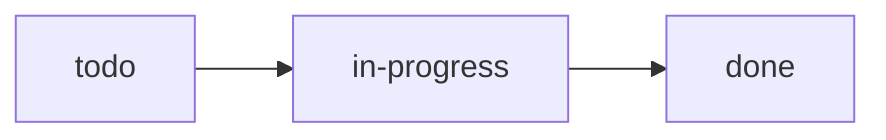

Колонки строятся по workflow проекта, см. [[Сайт студии]].



## Чек-лист
- [x] Колонки по workflow ^w1a
- [ ] Перетаскивание карточек [due:: 2026-11-08] ^w1b

## Комментарии

### 2026-11-02 12:30 · alice ^c-7f3a
Начала с макета, @bob посмотри.

```text
### это не новый комментарий
```

### 2026-11-02 13:05 · bob ^c-8b21
- [ ] задача из комментария не входит в чек-лист ^w1c
